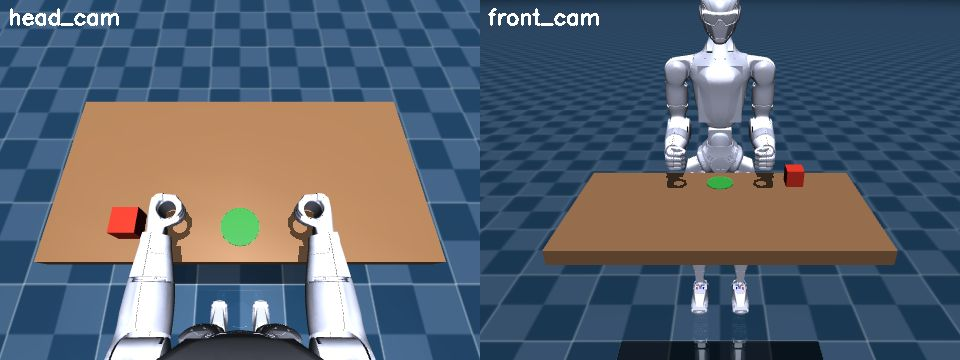
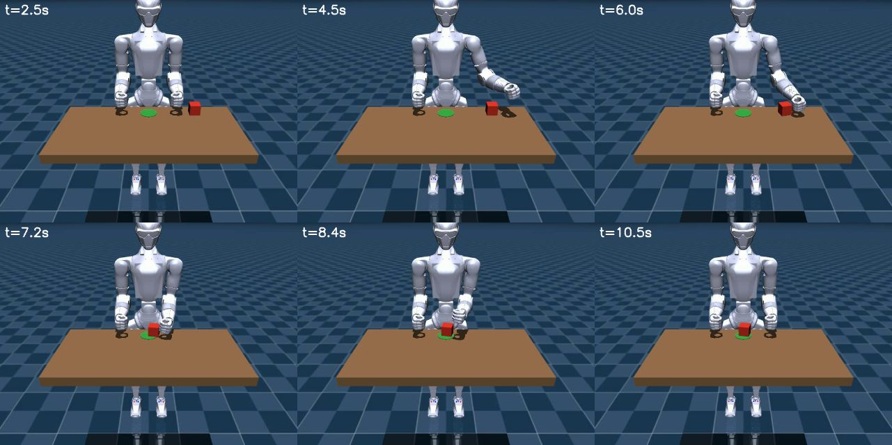

# r1.sim: Python 시뮬 (조작 장면)

`r1/sim/` 은 MuJoCo 를 직접 돌리는 우리 시뮬입니다. 실기·C++ 시뮬과 **같은 DDS 토픽**(`rt/lowcmd`, `rt/lowstate`, `unitree_hg`)을 쓰므로
`r1.interface`, `r1.kinematics` 코드가 수정 없이 동작합니다. 조작 장면(테이블·상자·목표·카메라)은 코드로 만듭니다.



| 파일 | 내용 |
|---|---|
| `scene.py` | `SceneConfig`, `build_model()`: R1 원본 모델 + 테이블·상자·목표 영역·카메라 (MjSpec, 원본 수정 없음) |
| `bridge.py` | `SimBridge`: LowCmd 수신, 매 스텝 PD 계산, LowState 발행 |
| `run.py` | 실시간 루프, 뷰어, 녹화, 고무줄, 디버그 출력 |
| `ros_camera.py` | `RosCameraPublisher`: 카메라 영상 → ROS2 `Image` + `CameraInfo` |

## 실행

```bash
source env/setup_sim.sh
python -m r1.sim.run                                # 골반 고정 + 테이블·상자 + 뷰어
python -m r1.sim.run --base band                    # 고무줄로 매단 상태 (C++ 시뮬과 같은 조건)
python -m r1.sim.run --headless                     # 뷰어 없이
python -m r1.sim.run --ros-cameras                  # 카메라 영상 → ROS2 (/camera/head|front/image_raw)
python -m r1.sim.run --record out.mp4               # 카메라 영상 녹화 (--record-cam head_cam)
python -m r1.sim.run --print-box --print-contacts   # 상자 위치, 팔 접촉 출력 (디버그)
```

그다음 다른 터미널에서 제어 코드를 실행합니다 (예: `python -m r1.kinematics.examples.push_box`).

| 옵션 | 기본값 | 의미 |
|---|---|---|
| `--base` | `fixed` | `fixed` 골반 고정(상체 조작용), `band` 고무줄, `free` 자유 |
| `--no-table` | | 테이블·상자 없이 |
| `--domain` / `--iface` | 1 / lo | DDS 설정 (`env/setup_sim.sh` 와 같아야 함) |
| `--ros-cameras`, `--cam-hz`, `--cam-size` | 끔, 15, 640x480 | 카메라 영상 ROS2 발행 |
| `--record`, `--record-cam`, `--record-fps` | | mp4 녹화 |
| `--ui` | 끔 | 뷰어 좌우 패널 표시 |

뷰어 키: `Tab` / `Shift+Tab` 좌우 설정 패널, `Backspace` 리셋, `9` 고무줄 켜기/끄기, `7` / `8` 고무줄 짧게/길게 (`--base band`).
마우스: 왼쪽 드래그 회전, 오른쪽 드래그 이동, 휠 확대.

- 뷰어 창은 1280×720 으로 뜬다. 좌우 패널은 기본으로 숨기고(`--ui` 로 표시), 시작 시점을 로봇 전신 + 테이블에 맞춘다
  (lookat (0.15, 0, 0.70), 거리 2.1 m, azimuth 200°, elevation -18°). 창이 터미널 뒤에 가려지면 작업 표시줄에서 꺼낸다.

## 장면 (`SceneConfig` 기본값, 골반 기준 좌표)

| 항목 | 값 | 근거 |
|---|---|---|
| 골반 높이 | 0.813 m (바닥 기준) | 기본 자세에서 발바닥이 바닥에 닿는 높이 |
| 테이블 윗면 | z = -0.05 (바닥 기준 0.763 m) | 팔 작업 영역 ([kinematics.md](kinematics.md)) |
| 테이블 범위 | x 0.20 ~ 0.60, y -0.40 ~ 0.40 | |
| 상자 | (0.27, 0.22), 한 변 0.05 m, 0.2 kg, 마찰 0.6 | 왼손 기본 자세와 겹치지 않게 |
| 목표 영역 | (0.27, 0.00), 반지름 0.04 m, 충돌 없음 | |
| `head_cam` | `torso_link` 기준 (0.10, 0, 0.42), (0.32, 0, -0.05) 를 봄, fovy 70 | 시뮬 모델에 머리가 없어 근사 위치 |
| `front_cam` | 월드 (1.3, 0, 1.3), 로봇 쪽을 봄, fovy 50 | 관찰·녹화용 |

## 카메라 → ROS2 (`--ros-cameras`)

| 토픽 | 타입 | 내용 |
|---|---|---|
| `/camera/head/image_raw` | `sensor_msgs/Image` (rgb8) | 머리 카메라 (torso_link 근사 위치) |
| `/camera/head/camera_info` | `sensor_msgs/CameraInfo` | 핀홀 파라미터 (fovy 70 → fx = fy = 342.8 @ 640x480) |
| `/camera/front/image_raw`, `/camera/front/camera_info` | | 정면 관찰 카메라 (fovy 50) |

```bash
source env/setup_sim.sh
python -m r1.sim.run --ros-cameras                 # 터미널 1
ros2 launch r1_bridge view.launch.py               # 터미널 2: RViz 에 로봇 + 카메라 패널 2개
```

- 렌더링은 시뮬 프로세스 안에서 한다 (시뮬 상태가 필요). 같은 프로세스에서 Unitree DDS 와 rclpy 가 함께 동작함을 확인했다.
- QoS 기본(reliable, depth 10). 프레임 id: `head_camera`, `front_camera` (TF 는 아직 발행하지 않음).
- 측정 (2026-10-18): 640x480 카메라 2대 렌더링 4.8 ms, 발행 0.3 ms/장. 머리 카메라 14.1 Hz.
  뷰어 + 카메라 + RViz + 브리지 + 제어 코드를 함께 돌리면 RTF 0.96 (단독 1.00).

## C++ 시뮬과의 차이

| | C++ 시뮬 (`sim/run_r1_sim.sh`) | Python 시뮬 (`r1.sim.run`) |
|---|---|---|
| 실시간 비율 (이 PC) | 약 0.6 (팔 낙하 시간 측정) | **1.00** (2초마다 출력) |
| PD 계산 | 브리지 스레드 1 kHz | 매 물리 스텝 (500 Hz) |
| 첫 명령 전 | 토크 0 (팔이 떨어짐) | 기본 자세 유지 |
| 장면 | R1 만 | 테이블·상자·목표·카메라 |
| 베이스 | 고무줄 | 고정 / 고무줄 / 자유 |
| 녹화·접촉 출력 | 없음 | 있음 |

C++ 시뮬은 원본 그대로 두고 비교·기준용으로 쓴다 ([decisions.md](decisions.md) D8, D12).

## 측정 결과 (2026-10-18)

| 항목 | C++ 시뮬 | Python 시뮬 |
|---|---|---|
| 팔꿈치 계단 응답 90% (kp 40) | 215 ms | **54 ms** (오프라인 계산 48 ms 와 일치) |
| 손 끝 직선 추종, 정지 | 3.0 mm | **0.4 mm** (양팔+허리 중력 보상) |
| 손 끝 직선 추종, 이동 중 평균 / 최대 | 20.2 / 34.1 mm | **4.0 / 10.6 mm** |
| 상자 밀기 | | (0.27, 0.22) → (0.253, 0.008), 목표까지 1.9 cm |



`python -m r1.kinematics.examples.push_box` 실행 결과 (front_cam 녹화).
