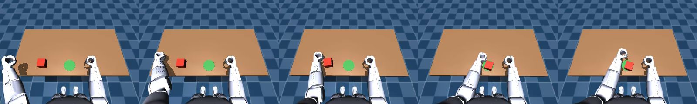

# r1.teleop: 키보드 원격조작 + LeRobot 데이터 기록

8단계. 사람이 키보드로 R1 왼손을 움직여 상자를 미는 시연을 하고, 그 과정을 LeRobot 데이터셋으로 저장합니다.
9단계(ACT 학습)의 입력이 됩니다.



머리 카메라로 기록된 에피소드 (0, 2, 4, 6, 7 초). 손이 상자 옆으로 가서 초록 원까지 밀었다.

| 파일 | 내용 |
|---|---|
| `record_push.py` | 메인 프로그램: 키 입력 → 손 끝 이동(IK) → 기록, 에피소드 관리 |
| `keyboard.py` | `KeyReader`: 터미널 키 입력 (cbreak, 백그라운드 스레드) |
| `dataset.py` | `EpisodeRecorder`: LeRobot 데이터셋 생성·이어쓰기, 에피소드 저장/버리기, 부가 정보 jsonl |
| `auto_push.py` | 자동 시연: 시뮬 상자 위치를 보고 스크립트가 밀며 기록 ([training.md](training.md)) |

## 실행

```bash
source env/setup_sim.sh
python -m r1.sim.run --ros --cam-hz 30 --cam-size 320x240      # 터미널 1: 시뮬
python -m r1.teleop.record_push                               # 터미널 2: 원격조작 (이 터미널에서 키 입력)
python -m r1.teleop.record_push --name my_set                 # 다른 이름의 데이터셋
```

**키 입력은 `record_push` 를 실행한 터미널에 포커스가 있을 때만** 받는다. 다른 창에 타이핑해도 로봇은 움직이지 않는다.

| 키 | 동작 |
|---|---|
| `w` / `s` | 손 앞 / 뒤 (x) |
| `a` / `d` | 손 왼쪽 / 오른쪽 (y) |
| `r` / `f` | 손 위 / 아래 (z) |
| `n` | 새 에피소드: 시뮬 리셋(상자 무작위 위치) + 손을 준비 위치 (0.24, 0.33, 0.08) 로 |
| `space` | 기록 시작 |
| `Enter` | 기록 끝 + 저장 |
| `x` | 기록 끝 + 버리기 |
| `q` | 종료 (데이터셋 마무리 — 꼭 `q` 로 끝낼 것) |
| `Ctrl+C` | 비상정지(damp) 후 종료 |

상태 줄에 손 끝 위치, 상자 위치, 상자-목표 거리가 표시된다. 거리 < 0.04 m 면 성공.

### 시연 요령

1. `n` → 손이 상자 왼쪽 위로 간다. `space` 로 기록 시작.
2. `w` / `s` 로 손을 상자와 같은 앞뒤 위치(x)에 맞춘다.
3. `f` 로 내린다 (아래 한계 = 밀기 높이에서 자동으로 멈춤).
4. `d` 를 눌러 오른쪽으로 민다. 상자가 초록 원에 들어가면 멈춘다.
5. `r` 로 손을 들고 `Enter` 로 저장.

- 키를 누르고 있으면 손이 0.08 m/s 로 움직인다. 터미널 자동 반복이 시작되기 전(0.3 ~ 0.5 s) 한 번 멈칫할 수 있다.
- 손 끝은 작업 영역 x 0.15 ~ 0.34, y -0.08 ~ 0.36, z 0.005 ~ 0.12 (골반 기준) 안으로 제한된다.
  z 하한은 주먹이 테이블에 닿지 않는 높이 ([kinematics.md](kinematics.md)).

## 데이터셋

- 위치: `data/datasets/<name>/` (git 제외, 서버로 `env/sync_to_server.sh push`)
- 형식: LeRobot 0.4.1, 데이터셋 v3.0, `repo_id = local/<name>`, `robot_type = unitree_r1`, 30 fps
- 같은 이름으로 다시 실행하면 이어서 기록한다 (특징 정의가 같아야 함).

| 키 | 모양 | 내용 |
|---|---|---|
| `observation.images.head` | (240, 320, 3) video | 머리 카메라 (AV1 mp4) |
| `observation.state` | (5,) float32 | 왼팔 관절 측정값 [rad]: shoulder_pitch, shoulder_roll, shoulder_yaw, elbow, wrist_roll |
| `action` | (5,) float32 | 왼팔 관절 **명령값** [rad] (IK 결과). 정책이 배울 출력 |
| `task` | str | `push the red box to the green circle` |

부가 정보 `data/datasets/<name>.episodes.jsonl` (에피소드당 한 줄, 시뮬 전용 정답값):

```json
{"episode_index": 0, "frames": 212, "box_start": [0.278, 0.187], "target_xy": [0.27, 0.0],
 "target_radius": 0.04, "box_end": [0.2581, -0.0123], "dist_to_target": 0.0171, "success": true}
```

불러오기:

```python
from lerobot.datasets.lerobot_dataset import LeRobotDataset
ds = LeRobotDataset("local/r1_push_box", root="data/datasets/r1_push_box")
```

설계 근거는 [decisions.md](decisions.md) D15.

## 시뮬 쪽 ROS2 인터페이스 (`r1.sim.run --ros`)

| 이름 | 종류 | 내용 |
|---|---|---|
| `/camera/head/image_raw` 등 | 토픽 | 카메라 ([sim.md](sim.md)) |
| `/r1_sim/box_pose` | 토픽 `PoseStamped` (pelvis_link) | 상자 위치 (카메라 주기) |
| `/r1_sim/reset` | 서비스 `std_srvs/Trigger` | 로봇 기본 자세 + 상자 무작위. message = JSON {box_xy, target_xy, target_radius} |

상자 범위: x 0.24 ~ 0.30, y 0.16 ~ 0.26 (`SceneConfig.box_x_range / box_y_range`). 시드: `--seed`.

## 시험 결과 (2026-10-18)

가상 터미널(`script`)에 키 입력을 시간에 맞춰 흘려 넣어 자동으로 시험했다 (시드 0, 첫 상자 (0.278, 0.187)).

| 항목 | 결과 |
|---|---|
| 에피소드 0 | 212 프레임 (0 → 7.03 s, 30 fps), 상자 → (0.258, -0.012), 목표까지 1.7 cm, **성공** |
| 에피소드 1 | 기록 시작 후 `x` → 버림 |
| `q` 종료 | 데이터셋 마무리, `LeRobotDataset` 으로 다시 불러오기 성공 |
| 저장 시간 | 에피소드당 약 1 s (영상 인코딩). 그동안 로봇은 자세 유지 |
| 크기 | 7 초 에피소드 약 1 MB |

## 실기에서

- 리셋 서비스와 상자 위치는 시뮬 전용이다. 실기에서는 사람이 상자를 놓고, 성공 판정도 사람이 한다 (`n` 은 손만 준비 위치로 보내도록 바꿀 예정).
- 머리 카메라 토픽 이름을 `/camera/head/image_raw` 로 맞추면 나머지는 그대로 쓴다 (`--image-topic` 으로 바꿀 수도 있음).
